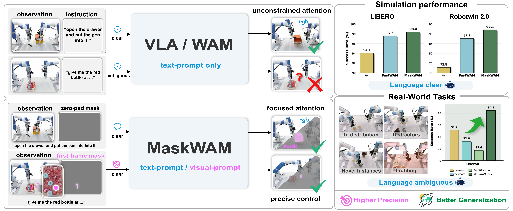
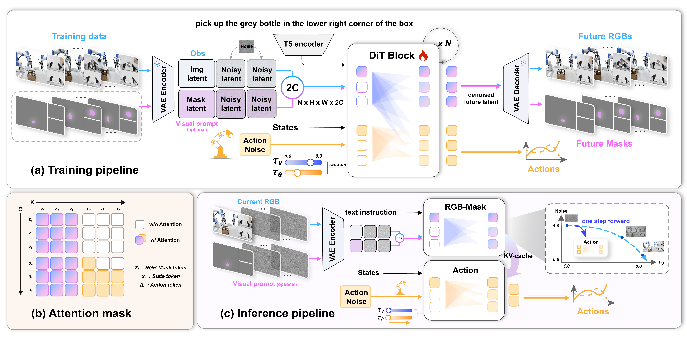

<div align="center">

# MaskWAM: Unifying Mask Prompting and Prediction for World-Action Models

<a href="https://arxiv.org/abs/2606.13515"></a> &nbsp;
<a href="https://hanyangyu1021.github.io/maskwam.github.io/"></a> &nbsp;
<a href="LICENSE"></a>

[Hanyang Yu](https://hanyangyu1021.github.io/)<sup>1</sup>,
[Haitao Lin](https://hetolin.github.io/)<sup>2</sup>,
[Jingbo Zhang](https://eckertzhang.github.io/)<sup>2</sup>,
[Wenyao Zhang](https://zhangwenyao1.github.io/)<sup>2</sup>,
[Chenghao Gu](https://chenghaogu.github.io/)<sup>3</sup>,
[Heng Li](https://hengli.me/)<sup>1</sup>,
[Ping Tan](https://ece.hkust.edu.hk/pingtan)<sup>1</sup>

<sup>1</sup>The Hong Kong University of Science and Technology
<sup>2</sup>Tencent Robotics X, <sup>3</sup>Tsinghua University



</div>

This repository is the official implementation of **MaskWAM: Unifying Mask
Prompting and Prediction for World-Action Models**.

MaskWAM is an object-centric world-action model that uses masks both as
first-frame spatial prompts and as future prediction targets. This release
contains the training and inference stack for real-robot/XTrainer data,
MaskWAM-Seg annotation tools, and the LIBERO data and evaluation pipeline.

## Highlights

- **Mask prompting for spatial grounding.** A first-frame target mask provides
  an explicit spatial anchor in cluttered or ambiguous scenes.
- **Future mask prediction.** Object-centric supervision encourages the model
  to focus on task-relevant regions.
- **Unified RGB-mask-action modeling.** RGB latents, mask latents, and action
  tokens are jointly modeled.
- **Real and simulated workflows.** The same training entry point supports
  XTrainer real-robot data and LIBERO.

<div align="center">

</div>

## Repository layout

```text
configs/                       Hydra training and dataset configurations
mask_wan_mot_real/             Real-robot/XTrainer model
mask_wan_mot_sim/              LIBERO model
wan22_core/                    WAN wrapper and required model internals
data/                          HDF5 dataset readers
platforms/real/                Real-data conversion and offline inference
platforms/libero/              LIBERO preparation, training, and evaluation
maskseg/                       MaskWAM-Seg annotation toolkit
playground/                    Offline click-to-mask inference demo
scripts/train_maskwam.py       Shared training entry point
tests/                         CPU-friendly structural and preprocessing tests
```

Large datasets, pretrained models, checkpoints, and experiment outputs are not
stored in Git. Available datasets and checkpoints are linked below.

## Installation

We recommend Linux, Python 3.10+, and an NVIDIA GPU for training or inference.

```bash
git clone https://github.com/hanyangyu1021/maskwam.git
cd maskwam

conda create -n maskwam python=3.10 -y
conda activate maskwam

# Install the PyTorch build matching your CUDA environment first.
pip install torch torchvision
pip install -r requirements.txt
pip install --no-build-isolation flash-attn
pip install -e . --no-deps
```

`flash-attn` is installed separately because it must be compiled against the
PyTorch/CUDA versions in the active environment. LIBERO and its simulator
dependencies follow the upstream LIBERO installation instructions.
See [`docs/INSTALL.md`](docs/INSTALL.md) for details.

## External assets

Configure paths with environment variables instead of editing source files:

```bash
export MASKWAM_ROOT="$PWD"
export MASKWAM_DATA_ROOT=/path/to/data
export MASKWAM_PRETRAINED_ROOT=/path/to/pretrained_models
export MASKWAM_WAN_PATH=/path/to/Wan2.2-TI2V-5B
export MASKWAM_CHECKPOINT_ROOT=/path/to/checkpoints
export MASKWAM_SAM3_ROOT="$PWD/third_party/sam3"  # optional after pip install -e
export PYTHONPATH="$MASKWAM_ROOT:$PYTHONPATH"
```

Download the required WAN2.2 base assets:

```bash
pip install -U huggingface_hub
hf download Wan-AI/Wan2.2-TI2V-5B \
  --local-dir "$MASKWAM_WAN_PATH"
```

For LIBERO, also set:

```bash
export LIBERO_ROOT=/path/to/LIBERO
export PYTHONPATH="$LIBERO_ROOT:$PYTHONPATH"
```

## Real-robot data

Download the released mask-prompt dataset from
[MaskWAM-realdata](https://www.modelscope.ai/datasets/hanyangyu1021/MaskWAM-realdata):

```bash
pip install -U modelscope-hub
export MODELSCOPE_ENDPOINT=https://www.modelscope.ai
ms download hanyangyu1021/MaskWAM-realdata \
  --repo-type dataset \
  --local-dir "$MASKWAM_DATA_ROOT/mask_prompt"
```

Download the released
[MaskWAM real-robot checkpoint](https://www.modelscope.ai/models/hanyangyu1021/MaskWAM-real-ckpt):

```bash
ms download hanyangyu1021/MaskWAM-real-ckpt \
  --local-dir "$MASKWAM_CHECKPOINT_ROOT/MaskWAM-real-ckpt"
```

The Playground uses this directory automatically when
`MASKWAM_CHECKPOINT_ROOT` is set.

To prepare new XTrainer recordings:

1. Convert source HDF5 files with
   [`platforms/real/realdata_utils/`](platforms/real/realdata_utils/).
2. Annotate target objects with [MaskWAM-Seg](maskseg/README.md).
3. Generate `segmentation_primary.npz` with
   `maskseg/tools/convert_sam_mask_to_segmentation.py`.

Train the real-robot model with:

```bash
scripts/train_maskwam.sh xtrainer \
  dataset.hdf5_dir=/path/to/converted_xtrainer
```

## LIBERO

The full preparation pipeline is documented in
[`platforms/libero/README.md`](platforms/libero/README.md):

1. Download LIBERO demonstrations.
2. Replay demonstrations to generate object masks.
3. Convert them to MaskWAM episode folders.
4. Compute state/action normalization statistics.

Download the released
[MaskWAM LIBERO checkpoint](https://www.modelscope.ai/models/hanyangyu1021/MaskWAM-libero-ckpt)
and its matching normalization statistics:

```bash
ms download hanyangyu1021/MaskWAM-libero-ckpt \
  --local-dir "$MASKWAM_CHECKPOINT_ROOT/MaskWAM-libero-ckpt"

ms download hanyangyu1021/MaskWAM-libero \
  libero_vam/qpos_mean_std_online.pkl \
  --repo-type dataset \
  --local-dir "$MASKWAM_DATA_ROOT"
```

To train directly on the released `libero_10_robot` data, download the complete
dataset instead:

```bash
ms download hanyangyu1021/MaskWAM-libero \
  --repo-type dataset \
  --local-dir "$MASKWAM_DATA_ROOT"
```

Train:

```bash
scripts/train_maskwam.sh libero
```

Evaluate:

```bash
scripts/eval_libero.sh \
  --task_suite libero_10
```

The eval defaults resolve to
`$MASKWAM_CHECKPOINT_ROOT/MaskWAM-libero-ckpt` and
`$MASKWAM_DATA_ROOT/libero_vam/qpos_mean_std_online.pkl`. The checkpoint and
evaluation dataset must use the same normalization file.

## MaskWAM-Seg

`maskseg/` provides a Qt annotation client, a Flask task server, and SAM3-based
video object segmentation. It supports positive/negative points, multiple
objects, bidirectional propagation, review rounds, and language annotation.

See:

- [English documentation](maskseg/README.md)
- [中文文档](maskseg/README_zh.md)

SAM3 source and checkpoints are external assets and are not vendored here.

## Offline playground

The Gradio playground loads one real-data frame, lets the user click the target
object, generates a SAM3 mask, and runs one MaskWAM prediction/action chunk. It
does not send actions to a robot.

```bash
scripts/playground.sh --host 127.0.0.1 --port 7860
```

See [`playground/README.md`](playground/README.md) for required assets and usage.

## Checkpoint compatibility

`checkpoint_loader.inspect_checkpoint()` validates the checkpoint model type,
mask settings, image dimensions, and action chunk before loading. Real-robot
checkpoints use `mask_wan_mot_real`; LIBERO checkpoints use
`mask_wan_mot_sim`.

Do not override `input_mask`, `predict_mask`, or action dimensions while
loading a checkpoint because these fields affect the network structure.

## Validation

CPU-friendly tests:

```bash
pytest -q
```

Syntax check:

```bash
python3 -m compileall -q \
  platforms scripts playground tests data \
  mask_wan_mot_real mask_wan_mot_sim wan22_core
```

Full inference requires compatible PyTorch/CUDA, WAN/VAE/T5, SAM3, checkpoint,
and normalization assets.

## License

MaskWAM is released under the [MIT License](LICENSE). The adapted Wan2.2 code
under `wan22_core/bak/wan/` remains under the
[Apache License 2.0](LICENSES/Apache-2.0.txt). MaskWAM-Seg adapts the
[RoboInter-Tools](https://github.com/InternRobotics/RoboInter/tree/main/RoboInterTools)
workflow under its [MIT License](LICENSES/RoboInter-MIT.txt).

## Citation

If you find MaskWAM useful, please cite:

```bibtex
@article{yu2026maskwam,
  title   = {MaskWAM: Unifying Mask Prompting and Prediction for World-Action Models},
  author  = {Hanyang Yu and Haitao Lin and Jingbo Zhang and Wenyao Zhang and Chenghao Gu and Heng Li and Ping Tan},
  journal = {arXiv preprint arXiv:2606.13515},
  year    = {2026}
}
```
