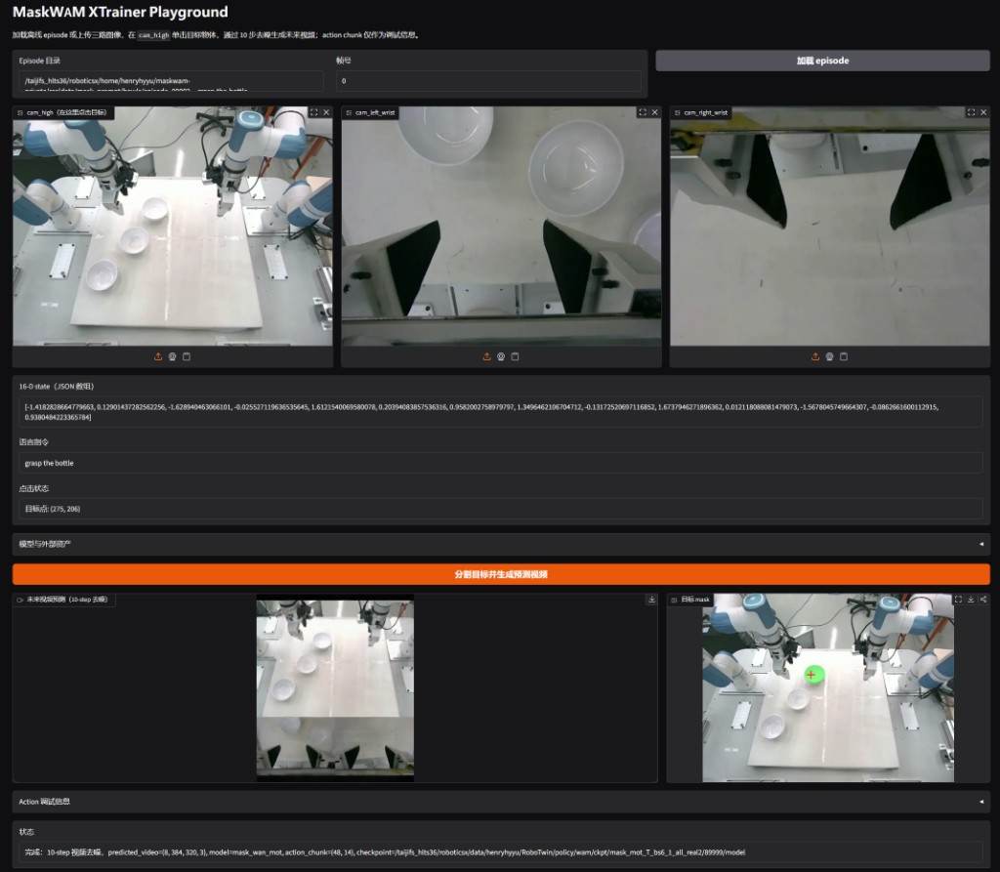

# MaskWAM XTrainer Playground

Playground 是一个离线可视化工具：从 XTrainer episode 读取三路相机和机器人
state，在 `cam_high` 中点击目标后，使用 SAM3 生成目标 mask，再由 MaskWAM
执行 10-step 去噪并展示预测的未来视频。Action chunk 仅作为调试信息，不会发送给
真实机器人。



## 工作流程

```text
浏览器（Gradio）
  └─ 三路图像 + state + 点击坐标
       ├─ SAM3 video predictor 生成首帧 mask
       ├─ MaskWAM 进行 10-step 视频去噪
       ├─ WAN VAE 解码 8 帧未来画面
       └─ PyAV 编码 H.264 MP4
```

## 环境

推荐使用 Linux、Python 3.10+ 和支持 CUDA 的 NVIDIA GPU。请先按照项目根目录
README 安装匹配当前 CUDA 版本的 PyTorch、FlashAttention 及模型依赖，然后安装
Playground 依赖：

```bash
python3 -m venv .venv
source .venv/bin/activate
pip install torch torchvision
pip install -r requirements.txt
pip install --no-build-isolation flash-attn
pip install -e . --no-deps
```

## 启动

```bash
cd /path/to/maskwam
source .venv/bin/activate

export MASKWAM_PRETRAINED_ROOT="$PWD/pretrained_models"
export MASKWAM_WAN_PATH="$PWD/pretrained_models/Wan2.2-TI2V-5B"
export MASKWAM_CHECKPOINT_ROOT="/path/to/checkpoints"
export MASKWAM_DATA_ROOT="/path/to/realdata"

scripts/playground.sh --host 127.0.0.1 --port 7860
```

打开 <http://localhost:7860>。

## 使用

1. 使用页面默认 episode，或填写 episode 目录和帧号后点击“加载 episode”。
2. 在 `cam_high` 图像中点击待操作目标。
3. 点击“分割目标并生成预测视频”。
4. 等待推理完成；首次运行会加载 SAM3、MaskWAM 和 WAN 权重。
5. 页面主区域展示预测视频和 SAM3 mask；Action 数据位于折叠的调试区域。

默认示例来自：

```text
realdata/mask_prompt/bowls/episode_00002__grasp-the-bottle
```

页面启动时直接读取 `assets/default_bowls/` 中保存的首帧 PNG 和
`frame_00000.json`，不会在启动阶段解码 MP4。

## 外部资产

页面默认需要：

- [MaskWAM real checkpoint](https://www.modelscope.ai/models/hanyangyu1021/MaskWAM-real-ckpt)：
  下载到 `$MASKWAM_CHECKPOINT_ROOT/MaskWAM-real-ckpt`
- 归一化统计：`platforms/real/realdata_utils/norm_all/qpos_mean_std_online.pkl`
- SAM3 checkpoint：`pretrained_models/sam3/sam3.pt`
- WAN/T5/VAE：`pretrained_models/Wan2.2-TI2V-5B`
- 可选的 episode 预计算 T5 embedding：`t5_seen.pt`

```bash
hf download Wan-AI/Wan2.2-TI2V-5B \
  --local-dir "$MASKWAM_WAN_PATH"

ms download hanyangyu1021/MaskWAM-real-ckpt \
  --local-dir "$MASKWAM_CHECKPOINT_ROOT/MaskWAM-real-ckpt"
```

state 使用训练一致的 `observations/state_qpos`（14 维），推理时再补齐到模型内部
维度；action chunk 为 `48 × 14`。

## 输出

每次推理结果默认保存在 `outputs/playground/`。主要输出包括：

```text
predicted_video_*.mp4
action_chunk_*.npy
```

预测视频由 10-step 完整去噪（`tau_v=0`）得到，当前输出 8 帧
`384 × 320` RGB 画面，并编码为浏览器兼容的 H.264/yuv420p。

## 常见问题

### 页面可以打开，但按钮报“请选择目标”

需要先在 `cam_high` 图像中单击目标物体。

### 后端完成但视频无法播放

确认输出使用 H.264 而不是 OpenCV 默认的 `mp4v`，并检查
`predicted_video.mp4` 是否存在。当前实现通过 PyAV/libx264 编码。

### `state 维度 16 与 norm 维度 14 不一致`

应读取 `observations/state_qpos`，不要使用 16 维的 `state_eep`。

### `WAN config.json not found`

`MASKWAM_WAN_PATH` 必须指向包含 `config.json` 的项目内
`pretrained_models/Wan2.2-TI2V-5B`，不能指向只有原始 WAN 权重的目录。
